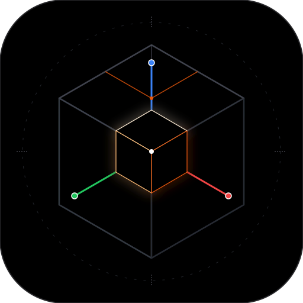
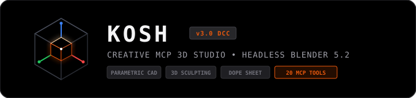
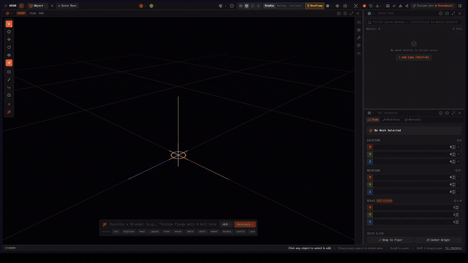

<p align="center">
  
</p>

<h1 align="center">K O S H (कौश)</h1>

<p align="center">
  <strong>Minimalist Developer-First Creative Model Context Protocol (MCP) Workstation</strong><br />
  <em>Real-Time Parametric 3D CAD • Digital Sculpting • Procedural Animation • Headless Blender 5.2 LTS</em>
</p>

<p align="center">
  <a href="https://www.blender.org/"></a>
  <a href="https://modelcontextprotocol.io/"></a>
  <a href="https://m8ven.ai/mcp/sachinyadavaug20-kosh-17wrcp?s=readme"></a>
  <a href="https://nextjs.org/"></a>
  <a href="https://spring.io/projects/spring-boot"></a>
  <a href="https://openjdk.org/"></a>
  <a href="LICENSE"></a>
</p>

<p align="center">
  
</p>

<p align="center">
  
</p>

> [!NOTE]
> **Live Demo Walkthrough**: Demonstrates real-time 3D model synthesis, interactive viewport manipulation, DCC inspector synchronization, and headless Blender MCP integration. High-resolution 60fps recording is also available at [assets/videos/demo.mp4](assets/videos/demo.mp4).

---

## Overview

**Kosh** (कौश — *treasury / vessel of creation*) is a high-performance, minimalist 3D workstation and **Model Context Protocol (MCP)** server hub. It bridges modern AI coding assistants with native desktop **Blender 5.2 LTS** in headless execution mode, allowing developers and designers to synthesize, manipulate, animate, and color 3D assets on the fly via JSON-RPC 2.0.

Built with a titanium-slate CAD workstation aesthetic, Kosh couples a **Spring Boot 3.3 / Java 21** MCP server with an interactive **Next.js 15 / Three.js** digital content creation (DCC) studio.

---

## Architecture

```text
 ┌─────────────────────────────────────────────────────────────┐
 │                LLM / AI Agent / MCP Client                  │
 │      (Claude Desktop / Antigravity / Cursor / Gemini)       │
 └──────────────────────────────┬──────────────────────────────┘
                                │ JSON-RPC 2.0 (POST /mcp)
                                ▼
 ┌─────────────────────────────────────────────────────────────┐
 │            Spring Boot 3.3 MCP Server (:8080)               │
 │  ├─ McpController (/mcp)        ├─ ShareController (/api)   │
 │  ├─ McpToolRegistry (23 Tools)  ├─ AssetController          │
 │  └─ GoogleGeminiClient (BYOK)   └─ BlenderExecutionService  │
 └──────────────────────────────┬──────────────────────────────┘
                                │ Subprocess Execution
                                ▼
 ┌─────────────────────────────────────────────────────────────┐
 │           Headless Blender Engine 5.2.1 LTS                 │
 │  ├─ bpy / bmesh                 ├─ Dynamic Sculpting        │
 │  ├─ Geometry Nodes              ├─ Shader Graph / Matcaps   │
 │  ├─ Rigid Body / Particle Sim   └─ GLTF/GLB/STL Exporters   │
 └──────────────────────────────┬──────────────────────────────┘
                                │ Compiled 3D Buffers (.glb)
                                ▼
 ┌─────────────────────────────────────────────────────────────┐
 │            Next.js 15 Terminal Studio (:3000)               │
 │  ├─ 3D Viewport Navigation Gizmo (6-Axis Depth-Projected)   │
 │  ├─ All-in-One Universal Transform Handles (Move/Rot/Scale) │
 │  ├─ Dope Sheet Animation Timeline with Keyframe Diamonds    │
 │  ├─ Multi-Palette CAD Theme Engine (Titanium/Blender/Nordic)│
 │  ├─ Standalone 1-File HTML Exporter & Share Route (/share)  │
 │  └─ Hardware-Accelerated Canvas Protractor & Marquee Engine │
 └─────────────────────────────────────────────────────────────┘
```

---

## Expanded Creative MCP Tools Suite

Kosh exposes a comprehensive suite of 46 native creative CAD and DCC tools over JSON-RPC 2.0 (`POST /mcp` and `GET /mcp/sse`):

### Precision 3D CAD & Engineering
| # | Tool Name | Domain | Description | Hints (RO, Destr, Idemp, OpenW) |
|---|---|---|---|---|
| 1 | `cad_create_primitive` | CAD Primitives | Precision parametric CAD solids (cube, cylinder, cone, sphere, torus) with constraints. | `false, false, false, false` |
| 2 | `cad_boolean_operation` | CSG Booleans | Exact manifold boolean operations (DIFFERENCE, UNION, INTERSECT). | `false, false, false, false` |
| 3 | `cad_apply_modifier` | CAD Modifiers | Numerical CAD modifiers (BEVEL, SUBSURF, MIRROR, SOLIDIFY). | `false, false, false, false` |
| 4 | `cad_inspect_scene` | Topology Audit | Vertex/face count, bounding box, dimensions, and watertight manifold status. | `true, false, true, false` |
| 5 | `cad_measure_dimensions`| Caliper Tool | Digital caliper measuring volume, bounding box, surface area, and 3D print readiness. | `true, false, true, false` |
| 6 | `cad_hollow_shell` | 3D Printing | Parametric hollow shelling with uniform wall thickness and resin drain holes. | `false, false, false, false` |
| 7 | `cad_generate_threads` | Fasteners | Precision ISO metric screw threads, bolts, and nuts with standardized pitch. | `false, false, false, false` |
| 8 | `cad_lattice_infill` | Lightweight | Procedural structural lattice infills (gyroid, honeycomb, wireframe). | `false, false, false, false` |
| 9 | `cad_apply_fillet_chamfer`| Edge Bevel | Metric edge rounding (fillet) or chamfer beveling via angle-limited modifier. | `false, false, false, false` |

### Instant Assembly & Kitbashing (Zero LLM Latency)
| # | Tool Name | Domain | Description | Hints (RO, Destr, Idemp, OpenW) |
|---|---|---|---|---|
| 10 | `cad_assemble_kit` | Assembly | Pre-baked parametric templates (flange, quadcopter, panel, truss, tree) in <10ms. | `false, false, true, false` |
| 11 | `cad_batch_csg` | Batch Pipeline | Sequential CSG booleans executed in one single transaction round-trip. | `false, false, false, false` |
| 12 | `cad_synthesize_composite`| Generative CAD | Multi-part composite CAD assembly from natural language with aesthetic styles. | `false, false, false, false` |
| 13 | `cad_compose_compound_scene`| Environments | Multi-subject compositions situated in rich cosmic/orbital environments. | `false, false, false, false` |
| 14 | `scene_assembler` | Staging | Multi-asset modular architecture and compound scene assembly. | `false, false, false, false` |

### Photorealistic Rendering & Studio Lighting
| # | Tool Name | Domain | Description | Hints (RO, Destr, Idemp, OpenW) |
|---|---|---|---|---|
| 15 | `cad_render_frame` | Beauty Render | Physically-based raytraced render via Blender EEVEE or Cycles engine. | `true, false, true, false` |
| 16 | `blender_render_frame` | Studio Render | Frame capture with transparent background, studio lighting, and framing. | `true, false, true, false` |
| 17 | `cad_studio_lighting_preset`| Lighting Rigs | 3-Point Classic, Cyberpunk Neon, Product Softbox, and Dramatic Rim rigs. | `false, false, false, false` |
| 18 | `cad_apply_pbr_preset`| PBR Presets | Calibrated optical materials (Titanium, Carbon Fiber, Glass, Gold, Obsidian). | `false, false, false, false` |
| 19 | `cad_batch_multiview_render`| Blueprints | 4-view orthographic and isometric blueprint engineering frames. | `true, false, true, false` |
| 20 | `lighting_studio` | Custom Rig | Custom photographic lighting rigs, cyclorama infinity backdrops. | `false, false, false, false` |
| 21 | `material_shader` | Shader Graph | Procedural Principled BSDF node trees with micro-displacement. | `false, false, false, false` |
| 22 | `camera_compositor` | Director Rig | Cinematic camera rigs: 360-degree turntable orbits, dolly tracks, macro lenses. | `false, false, false, false` |

### Digital Sculpting, Animation & Multi-Domain
| # | Tool Name | Domain | Description | Hints (RO, Destr, Idemp, OpenW) |
|---|---|---|---|---|
| 23 | `blender_sculpt_op` | Sculpting | Digital sculpting brushes (clay, crease, inflate, grab) & dynamic remeshing. | `false, false, false, false` |
| 24 | `blender_mesh_ops` | BMesh Ops | Manifold CSG booleans, chamfer bevels, solidification, and decimation. | `false, false, false, false` |
| 25 | `blender_uv_paint` | Texturing | Smart UV Project unwrapping, normal map baking, and vertex colors. | `false, false, false, false` |
| 26 | `blender_animate_pipeline`| Kinematics | Baked keyframed rigid body falls, cloth drapery, wave deforms, turntables. | `false, false, false, false` |
| 27 | `geometry_nodes` | Algorithmic | Procedural Geometry Node networks, point scattering, and lattices. | `false, false, false, false` |
| 28 | `kosh_svg_to_3d` | 2D to 3D | Extrudes 2D vector SVG path coordinates into beveled 3D solids. | `false, false, false, false` |
| 29 | `kosh_audio_reactive` | Audio Motion | 16-band frequency equalizer bars and concentric spectrum rings. | `false, false, false, false` |
| 30 | `kosh_ascii_to_voxel` | Voxel Engine | Synthesizes multi-layered 3D voxel grid sculptures from ASCII templates. | `false, false, false, false` |
| 31 | `kosh_cad_export_step` | Engineering | Precision engineered CAD models (spur gears, flange bearings, mounts). | `false, false, false, false` |
| 32 | `mcp_check_tool` | Trust Index | Vets any MCP server across 120,000+ indexed servers via M8ven Trust Index. | `true, false, true, true` |
| 33 | `kosh_system_health` | Telemetry | Live operational diagnostics, Blender 5.2 LTS status, and daemon telemetry. | `true, false, true, true` |

---

## Core Studio Features

### 1. Modern 3D Viewport Navigation Gizmo
- **6-Axis Real-Time Depth Sorting:** Projects cardinal axes (`+X`, `-X`, `+Y`, `-Y`, `+Z`, `-Z`) via `camera.matrixWorldInverse`. Back axes render with subtle dashed stems and muted dots; front axes render with solid stems and sharp circular pill badges.
- **Smooth Easing Snap:** Clicking any axis animates the viewport camera into orthogonal alignment over 300ms using ease-out cubic interpolation (`1 - (1 - t)³`).
- **Interactive Drag Orbit:** Dragging anywhere on the gizmo background disc smoothly orbits the scene in spherical coordinates.
- **Center Isometric Hub:** Center dot resets the camera view smoothly to Isometric (`iso`).
- **HUD Mode Pill:** Displays current view (e.g. `FRONT ORTHO`, `USER PERSPECTIVE`) with 1-click Perspective / Orthographic projection toggle.

### 2. Universal Transform Gizmo
- **Unified Axis Progression:**
  - `(0, 0, 0)`: Chamfered Zinc-white cube for uniform 3-axis scaling (`0.18`).
  - `0.28`: Planar drag squares (XY Amber, XZ Cyan, YZ Purple) for smooth 2D sliding.
  - `0.65`: Scale cubes positioned cleanly along shafts inside the rotation ring envelope.
  - `0.85`: Rotation arc torus rings (`0.016` tube radius, 64 segments).
  - `1.15`: Translation arrow cones (`0.075` radius).
- **Dedicated Modes:** Seamlessly switch between `All (Q)`, `Select (V)`, `Move (W)`, `Rotate (E)`, and `Scale (R)`.
- **Z-Fighting Prevention:** Visual handles render with `renderOrder = 99999` and `depthTest = false`.

### 3. Dope Sheet Animation Timeline
- **Keyframe Diamond Markers (`◆`):** Visual indicators at transformation keyframes. Click diamonds to snap the scrubber head; drag diamonds to retime the sequence.
- **Parametric Exploded View Slider:** 0% to 100% real-time disassembly slider using bounding box radial displacement vectors.
- **Playback Controls:** Play/Pause, Rewind, Looping, Frame counter, and Timecode display (`00:00:00`).

### 4. 2-Way Blender Script Ingestion & Standalone HTML Export
- **Paste `bpy` Script:** Paste raw Python scripts copied from Blender's Scripting workspace. The backend executes them headlessly and streams the resulting `.glb` directly into the viewport.
- **Standalone 1-File HTML Exporter:** Exports an autonomous, self-contained single `.html` file embedding the model buffer (Base64) and Three.js from CDN with OrbitControls, directional lighting, and turntable rotation—zero server required.
- **Community Model Sharing & 1-Click Forking:** Share creations via `/share/[id]` with 3D cards, metadata, and an instant `[ Fork in Kosh Studio ]` workflow.

---

## Prerequisites

Ensure the following tools are installed and available in `$PATH`:

| Requirement | Minimum Version | Verification |
|---|---|---|
| **Java** | OpenJDK 21+ | `java -version` |
| **Maven** | 3.9+ | `mvn -version` |
| **Node.js** | 20+ (20.x, 22.x, or newer) | `node -v` |
| **npm** | 10+ | `npm -v` |
| **Blender** | 4.x / 5.x LTS | `blender --version` |

---

## Quickstart

### Automated 1-Click Boot
Run the bootloader script, which verifies prerequisites, compiles the backend, and boots both services:
```bash
chmod +x run.sh
./run.sh
```

- **Web Studio:** [http://localhost:3000](http://localhost:3000)
- **MCP Server:** [http://localhost:8080](http://localhost:8080)
- **Health Check:** `curl http://localhost:8080/api/health`

### Manual Run

#### 1. Backend MCP Server (Port 8080)
```bash
cd backend
mvn clean spring-boot:run
```

#### 2. Frontend Terminal Studio (Port 3000)
```bash
cd frontend
npm install
npm run dev
```

---

## MCP Usage (JSON-RPC 2.0)

### 1. List Available Tools
```bash
curl -s -X POST http://localhost:8080/mcp \
  -H "Content-Type: application/json" \
  -d '{
    "jsonrpc": "2.0",
    "id": 1,
    "method": "tools/list"
  }' | jq
```

### 2. Execute 3D Mesh Tool (`blender_mesh`)
```bash
curl -s -X POST http://localhost:8080/mcp \
  -H "Content-Type: application/json" \
  -H "X-Google-Key: YOUR_GEMINI_API_KEY" \
  -d '{
    "jsonrpc": "2.0",
    "id": 2,
    "method": "tools/call",
    "params": {
      "name": "cad_model",
      "arguments": {
        "prompt": "Precision billet aluminum impeller with keyed center bore and perimeter bolt circle",
        "format": "glb"
      }
    }
  }' | jq
```

---

## Keyboard Shortcuts Cheat Sheet

| Key | Action |
|---|---|
| `Q` | All-In-One Universal Gizmo (Move, Rotate, Scale) |
| `V` | Select Mode (Pure raycast selection) |
| `W` | Move / Translate Gizmo |
| `E` | Rotate Gizmo |
| `R` | Scale Gizmo |
| `G` / `R` / `S` | Blender Modal Transform (Grab, Rotate, Scale with numeric input) |
| `Enter` | Commit Active Modal Transform |
| `Esc` | Cancel Modal Transform or Deselect |
| `A` / `Alt + A` | Select All / Deselect All |
| `Numpad 1` / `Ctrl + 1` | Front View (+Z) / Back View (-Z) |
| `Numpad 3` / `Ctrl + 3` | Right View (+X) / Left View (-X) |
| `Numpad 7` / `Ctrl + 7` | Top View (+Y) / Bottom View (-Y) |
| `Numpad 0` | Reset to Isometric Perspective View |
| `Numpad 5` | Toggle Perspective / Orthographic Projection |
| `F` / `.` | Frame / Focus Camera on Selected Mesh |
| `Alt + Z` | Toggle X-Ray Transparency |
| `Z` | Shading Pie Menu (Solid, Wireframe, Material, Normals) |
| `T` | Toggle Left Generator Panel |
| `N` | Toggle Right Code Inspector Drawer |
| `F1` or `?` | Open Hotkeys Cheat Sheet |

---

## Author & Security Verification
 
- **Project:** KOSH (Minimalist Creative MCP Hub)
- **Author:** Sachin SureshChandra Yadav ([@SachinyadavAug20](https://github.com/SachinyadavAug20))
- **Event:** BharatCode Build League 2026
- **License:** Apache 2.0 ([LICENSE](LICENSE))
- **Privacy Policy:** [PRIVACY.md](PRIVACY.md)
- **M8ven Trust Index Verification:**
  [](https://m8ven.ai/mcp/sachinyadavaug20-kosh-17wrcp?s=readme)
- **Recursive MCP Vetting:** Built-in `mcp_check_tool` against 120,000+ indexed Model Context Protocol servers
