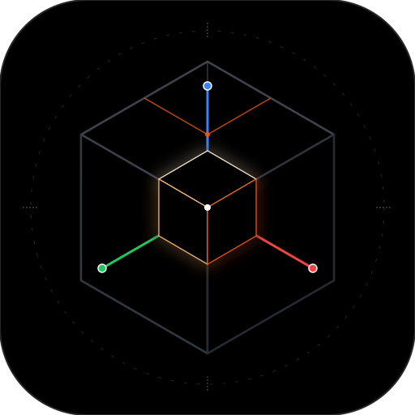
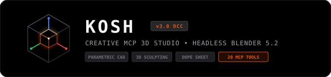

<p align="center">
  
</p>

<h1 align="center">K O S H (कौश)</h1>

<p align="center">
  <strong>Minimalist Developer-First Creative Model Context Protocol (MCP) Workstation</strong><br />
  <em>Real-Time Parametric 3D CAD • Digital Sculpting • Procedural Animation • Headless Blender 5.2 LTS</em>
</p>

<p align="center">
  <a href="https://www.blender.org/"></a>
  <a href="https://modelcontextprotocol.io/"></a>
  <a href="https://nextjs.org/"></a>
  <a href="https://spring.io/projects/spring-boot"></a>
  <a href="https://openjdk.org/"></a>
  
</p>

<p align="center">
  
</p>

<p align="center">
  <video src="assets/videos/demo.mp4" width="100%" controls autoplay loop muted></video>
</p>

> [!NOTE]
> **Watch the Live Demo Walkthrough**: [assets/videos/demo.mp4](assets/videos/demo.mp4) demonstrates real-time 3D model synthesis, interactive viewport manipulation, DCC inspector synchronization, and headless Blender MCP integration.

---

## Overview

**Kosh** (कौश — *treasury / vessel of creation*) is a high-performance, minimalist 3D workstation and **Model Context Protocol (MCP)** server hub. It bridges modern AI coding assistants with native desktop **Blender 5.2 LTS** in headless execution mode, allowing developers and designers to synthesize, manipulate, animate, and color 3D assets on the fly via JSON-RPC 2.0.

Built with a titanium-slate CAD workstation aesthetic, Kosh couples a **Spring Boot 3.3 / Java 21** MCP server with an interactive **Next.js 15 / Three.js** digital content creation (DCC) studio.

---

## Architecture

```text
 ┌─────────────────────────────────────────────────────────────┐
 │                LLM / AI Agent / MCP Client                  │
 │      (Claude Desktop / Antigravity / Cursor / Gemini)       │
 └──────────────────────────────┬──────────────────────────────┘
                                │ JSON-RPC 2.0 (POST /mcp)
                                ▼
 ┌─────────────────────────────────────────────────────────────┐
 │            Spring Boot 3.3 MCP Server (:8080)               │
 │  ├─ McpController (/mcp)        ├─ ShareController (/api)   │
 │  ├─ McpToolRegistry (20 Tools)  ├─ AssetController          │
 │  └─ GoogleGeminiClient (BYOK)   └─ BlenderExecutionService  │
 └──────────────────────────────┬──────────────────────────────┘
                                │ Subprocess Execution
                                ▼
 ┌─────────────────────────────────────────────────────────────┐
 │           Headless Blender Engine 5.2.1 LTS                 │
 │  ├─ bpy / bmesh                 ├─ Dynamic Sculpting        │
 │  ├─ Geometry Nodes              ├─ Shader Graph / Matcaps   │
 │  ├─ Rigid Body / Particle Sim   └─ GLTF/GLB/STL Exporters   │
 └──────────────────────────────┬──────────────────────────────┘
                                │ Compiled 3D Buffers (.glb)
                                ▼
 ┌─────────────────────────────────────────────────────────────┐
 │            Next.js 15 Terminal Studio (:3000)               │
 │  ├─ 3D Viewport Navigation Gizmo (6-Axis Depth-Projected)   │
 │  ├─ All-in-One Universal Transform Handles (Move/Rot/Scale) │
 │  ├─ Dope Sheet Animation Timeline with Keyframe Diamonds    │
 │  ├─ Multi-Palette CAD Theme Engine (Titanium/Blender/Nordic)│
 │  ├─ Standalone 1-File HTML Exporter & Share Route (/share)  │
 │  └─ Hardware-Accelerated Canvas Protractor & Marquee Engine │
 └─────────────────────────────────────────────────────────────┘
```

---

## 20 Native Creative MCP Tools

Kosh exposes 20 native creative tools over JSON-RPC 2.0 at `POST /mcp`:

| # | Tool Name | Domain | Description |
|---|---|---|---|
| 1 | `blender_mesh` | Core Mesh | Generative parametric 3D mesh modeling via Python `bpy`. |
| 2 | `cad_model` | Precision CAD | CSG boolean unions, precision chamfers, fillets, center bores, and bolt circles. |
| 3 | `blender_sculpt_op` | Sculpting | Digital sculpting displacements (clay, crease, inflate, grab, smooth, flatten, pinch) & dynamic remeshing. |
| 4 | `blender_geometry_nodes` | Procedural | Node trees for array scattering, voronoi displacement, and mathematical surface lattices. |
| 5 | `blender_shader_graph` | Materials | Node-based procedural shading: Car Paint, Brushed Metal, Iridescent Glass, Hologram, and Matcaps. |
| 6 | `blender_animate_pipeline`| Kinematics | Multi-element mechanical sequences, exploded views, orbital fly-bys, and morphing. |
| 7 | `blender_bmesh_ops` | Topology | Non-destructive mesh edits: Extrude, Inset, Bevel, Bisect, Bridge, and Subdivide. |
| 8 | `blender_physics_sim` | Simulation | Rigid body drops, active collider simulations, restitution, and gravity physics. |
| 9 | `blender_uv_paint` | UV & Textures | Smart projection unwrap, checkerboard distortion inspection, and procedural face painting. |
| 10 | `blender_camera_stage` | Staging | Studio lighting rigs (3-Point, Rim, High-Key, Low-Key) and cinematic lens framing. |
| 11 | `blender_modifiers` | Modifiers | Procedural stacks: Subdivision Surface, Mirror, Boolean, Solidify, Wireframe, Curve Deform. |
| 12 | `blender_quick_sculpt` | Direct Sculpt | Instant organic surface detailing and vertex deformation. |
| 13 | `blender_simulations` | Dynamics | Cloth drape, soft-body bounce, smoke flows, and particle spray kinematics. |
| 14 | `blender_scene_pipeline`| Multi-Domain | Complete end-to-end multi-asset 3D composition with lighting, materials, and motion. |
| 15 | `blender_rigging` | Armatures | Bone armatures, inverse kinematics (IK), vertex weight painting, and joint constraints. |
| 16 | `blender_studio_stage` | Environment | Stage composition, backdrop cycs, ground contact shadows, and HDRI lighting. |
| 17 | `kosh_svg_to_3d` | 2D to 3D | Extrudes 2D vector SVG path coordinates into beveled 3D solids with custom bevel depth. |
| 18 | `kosh_audio_reactive` | Audio Motion | 16-band frequency equalizer bars driven by simulated procedural audio waveforms. |
| 19 | `kosh_ascii_to_voxel` | Voxel Engine | Synthesizes multi-layered 3D voxel grid sculptures from raw ASCII art templates. |
| 20 | `kosh_cad_export_step` | CAD Standards | Generates precision engineered CAD models and exports cross-platform geometries. |

---

## Core Studio Features

### 1. Modern 3D Viewport Navigation Gizmo
- **6-Axis Real-Time Depth Sorting:** Projects cardinal axes (`+X`, `-X`, `+Y`, `-Y`, `+Z`, `-Z`) via `camera.matrixWorldInverse`. Back axes render with subtle dashed stems and muted dots; front axes render with solid stems and sharp circular pill badges.
- **Smooth Easing Snap:** Clicking any axis animates the viewport camera into orthogonal alignment over 300ms using ease-out cubic interpolation (`1 - (1 - t)³`).
- **Interactive Drag Orbit:** Dragging anywhere on the gizmo background disc smoothly orbits the scene in spherical coordinates.
- **Center Isometric Hub:** Center dot resets the camera view smoothly to Isometric (`iso`).
- **HUD Mode Pill:** Displays current view (e.g. `FRONT ORTHO`, `USER PERSPECTIVE`) with 1-click Perspective / Orthographic projection toggle.

### 2. Universal Transform Gizmo
- **Unified Axis Progression:**
  - `(0, 0, 0)`: Chamfered Zinc-white cube for uniform 3-axis scaling (`0.18`).
  - `0.28`: Planar drag squares (XY Amber, XZ Cyan, YZ Purple) for smooth 2D sliding.
  - `0.65`: Scale cubes positioned cleanly along shafts inside the rotation ring envelope.
  - `0.85`: Rotation arc torus rings (`0.016` tube radius, 64 segments).
  - `1.15`: Translation arrow cones (`0.075` radius).
- **Dedicated Modes:** Seamlessly switch between `All (Q)`, `Select (V)`, `Move (W)`, `Rotate (E)`, and `Scale (R)`.
- **Z-Fighting Prevention:** Visual handles render with `renderOrder = 99999` and `depthTest = false`.

### 3. Dope Sheet Animation Timeline
- **Keyframe Diamond Markers (`◆`):** Visual indicators at transformation keyframes. Click diamonds to snap the scrubber head; drag diamonds to retime the sequence.
- **Parametric Exploded View Slider:** 0% to 100% real-time disassembly slider using bounding box radial displacement vectors.
- **Playback Controls:** Play/Pause, Rewind, Looping, Frame counter, and Timecode display (`00:00:00`).

### 4. 2-Way Blender Script Ingestion & Standalone HTML Export
- **Paste `bpy` Script:** Paste raw Python scripts copied from Blender's Scripting workspace. The backend executes them headlessly and streams the resulting `.glb` directly into the viewport.
- **Standalone 1-File HTML Exporter:** Exports an autonomous, self-contained single `.html` file embedding the model buffer (Base64) and Three.js from CDN with OrbitControls, directional lighting, and turntable rotation—zero server required.
- **Community Model Sharing & 1-Click Forking:** Share creations via `/share/[id]` with 3D cards, metadata, and an instant `[ Fork in Kosh Studio ]` workflow.

---

## Prerequisites

Ensure the following tools are installed and available in `$PATH`:

| Requirement | Minimum Version | Verification |
|---|---|---|
| **Java** | OpenJDK 21+ | `java -version` |
| **Maven** | 3.9+ | `mvn -version` |
| **Node.js** | 20+ (20.x, 22.x, or newer) | `node -v` |
| **npm** | 10+ | `npm -v` |
| **Blender** | 4.x / 5.x LTS | `blender --version` |

---

## Quickstart

### Automated 1-Click Boot
Run the bootloader script, which verifies prerequisites, compiles the backend, and boots both services:
```bash
chmod +x run.sh
./run.sh
```

- **Web Studio:** [http://localhost:3000](http://localhost:3000)
- **MCP Server:** [http://localhost:8080](http://localhost:8080)
- **Health Check:** `curl http://localhost:8080/api/health`

### Manual Run

#### 1. Backend MCP Server (Port 8080)
```bash
cd backend
mvn clean spring-boot:run
```

#### 2. Frontend Terminal Studio (Port 3000)
```bash
cd frontend
npm install
npm run dev
```

---

## MCP Usage (JSON-RPC 2.0)

### 1. List Available Tools
```bash
curl -s -X POST http://localhost:8080/mcp \
  -H "Content-Type: application/json" \
  -d '{
    "jsonrpc": "2.0",
    "id": 1,
    "method": "tools/list"
  }' | jq
```

### 2. Execute 3D Mesh Tool (`blender_mesh`)
```bash
curl -s -X POST http://localhost:8080/mcp \
  -H "Content-Type: application/json" \
  -H "X-Google-Key: YOUR_GEMINI_API_KEY" \
  -d '{
    "jsonrpc": "2.0",
    "id": 2,
    "method": "tools/call",
    "params": {
      "name": "cad_model",
      "arguments": {
        "prompt": "Precision billet aluminum impeller with keyed center bore and perimeter bolt circle",
        "format": "glb"
      }
    }
  }' | jq
```

---

## Keyboard Shortcuts Cheat Sheet

| Key | Action |
|---|---|
| `Q` | All-In-One Universal Gizmo (Move, Rotate, Scale) |
| `V` | Select Mode (Pure raycast selection) |
| `W` | Move / Translate Gizmo |
| `E` | Rotate Gizmo |
| `R` | Scale Gizmo |
| `G` / `R` / `S` | Blender Modal Transform (Grab, Rotate, Scale with numeric input) |
| `Enter` | Commit Active Modal Transform |
| `Esc` | Cancel Modal Transform or Deselect |
| `A` / `Alt + A` | Select All / Deselect All |
| `Numpad 1` / `Ctrl + 1` | Front View (+Z) / Back View (-Z) |
| `Numpad 3` / `Ctrl + 3` | Right View (+X) / Left View (-X) |
| `Numpad 7` / `Ctrl + 7` | Top View (+Y) / Bottom View (-Y) |
| `Numpad 0` | Reset to Isometric Perspective View |
| `Numpad 5` | Toggle Perspective / Orthographic Projection |
| `F` / `.` | Frame / Focus Camera on Selected Mesh |
| `Alt + Z` | Toggle X-Ray Transparency |
| `Z` | Shading Pie Menu (Solid, Wireframe, Material, Normals) |
| `T` | Toggle Left Generator Panel |
| `N` | Toggle Right Code Inspector Drawer |
| `F1` or `?` | Open Hotkeys Cheat Sheet |

---

## Author & Verification

- **Project:** KOSH (Minimalist Creative MCP Hub)
- **Author:** Sachin SureshChandra Yadav ([@SachinyadavAug20](https://github.com/SachinyadavAug20))
- **Event:** BharatCode Build League 2026
- **License:** Apache 2.0
